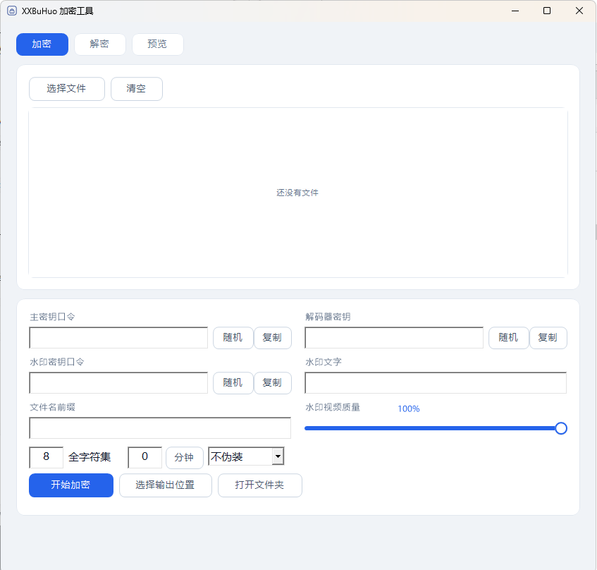

# XXBuHuo EncryptTool

> 

XXBuHuo EncryptTool 是一款文件与媒体加密工具，支持**纯净母盘 / 水印审查版**双通道封装、双层密钥、随机口令、有效期控制与诱饵数据。

---

## 主要功能

- **双通道封装**：同一档案内同时存放「纯净原始母盘」与「水印审查版」，用不同口令提取
- **双层加密**：可选解码器密钥（第二把钥匙），只破开外层无法还原内容
- **强加密算法**：Argon2id 内存硬密钥派生 + XChaCha20-Poly1305 认证加密
- **全字符集口令**：中文、英文、数字、特殊符号、注音符号、拼音声调，一键随机生成
- **伪装输出**：可把加密档案伪装成普通文本
- **内置播放器**：解密后直接在窗口内预览图片、文本、视频

---

## 下载

从 [Releases](../../releases) 页面下载对应平台的可执行文件：

## 安全须知

- 口令是唯一防线，请点「随机」按钮生成 12 位以上强口令
- 主口令与水印口令请区分，并通过**不同渠道**告知接收方
- 双层档案的解码器密钥务必单独保存，遗失后无法恢复
- 本工具**没有后门**，忘记口令无法找回
- 伪装文件请按「文件」方式发送；

---

## 许可协议

本软件为**专有软件**，源码不公开。获得授权者可在合法范围内使用可执行文件，不得反编译、二次分发或用于违法用途。详见 [LICENSE](LICENSE)。

---

## 反馈

问题与建议请通过 [Issues](../../issues) 提交。
